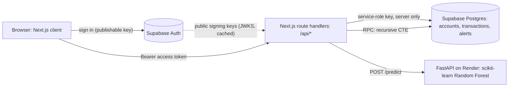

# MuleWatch

Transaction risk scoring and fraud-network investigation prototype. Analysts
triage model alerts, trace money movement between accounts on an interactive
graph, and score new transactions with a Random Forest model.

> MuleWatch is a research prototype built on **PaySim**, a synthetic mobile-money
> dataset. It contains no real customer data, its scores are risk estimates for
> human review, and it does not block payments.

## Architecture



| Part | Location | Role |
| --- | --- | --- |
| Analyst app | `frontend/` | Next.js 16 (App Router, React 19, Tailwind 4). Alerts, Network, Evaluate. |
| Route handlers | `frontend/src/app/api/` | The only code that holds the service-role key. Every route verifies the caller's Supabase token. |
| Inference API | `api/main.py` | FastAPI service that loads `api/models/fraud_detection_rf.joblib` once and applies a tuned threshold. |
| Training | `api/train_model.py`, `api/evaluate_model.py` | Builds the pipeline from `data/processed/paysim_sample_100k.csv` and writes metrics. |
| Seeding | `scripts/upload_paysim_to_supabase.py` | Loads the PaySim sample into Supabase and creates labelled demonstration alerts. |

**Why the model is a separate service.** The model is a Python/scikit-learn
artefact; keeping it behind a small HTTP API lets the web app stay a pure
TypeScript deployment, lets the model be retrained and redeployed on its own,
and keeps the database credentials out of the inference service entirely (it
never talks to Supabase).

## How the pieces work

### Risk scores
1. Evaluate sends eight features (`step, type, amount, oldbalanceOrg,
   oldbalanceDest, orig_txn_count_before, dest_txn_count_before,
   dest_is_merchant`) to `/api/predict`.
2. The route validates them, forwards only those features to FastAPI (90 s
   timeout for Render cold starts), and validates the response.
3. FastAPI builds a one-row DataFrame in the exact training column order and
   returns `fraud_probability`; `predicted_is_fraud` means the probability met
   the threshold in `api/models/fraud_threshold.json` (0.405, chosen for F1 on
   out-of-fold training predictions).
4. The route upserts the transaction by `external_transaction_id` (the browser
   reuses the same ID on retry, so a lost response does not create a duplicate)
   and opens one alert if the model flagged it.

### Four things the UI keeps separate
- **Model risk** – a probability and the severity derived from it.
- **PaySim label** – the synthetic dataset's `isFraud` ground truth, shown in
  violet with a dashed outline, used only for demonstration alerts.
- **Review status** – open → investigating → resolved, set by an analyst.
- **Association** – an account that *touches* a flagged transaction. The graph
  marks it, and the UI states that this is not a finding about the account.

### Alert queue
`/api/alerts` filters (status, severity, source), sorts (risk, newest, oldest)
and pages in the database, returning one page of 25 with an exact total, so
every unresolved alert is reachable. The URL holds the same parameters, and
`lib/alert-filters.ts` parses them for both the browser and the route. The
linked transaction is embedded through the `alerts.transaction_id` foreign key;
a reference search becomes an inner join on it, and a full UUID matches an
alert or transaction ID. A page past the end returns the last page.

### Asynchronous ingestion (optional)
`POST /api/qstash/transactions` (QStash, signed) and `POST /api/transactions/queue`
(Kafka producer → FastAPI consumer) score transactions in the background through
the same `/api/predict` logic. The UI still calls `/api/predict` directly. See
[`docs/KAFKA.md`](docs/KAFKA.md) for setup, retry/DLQ rules and the Render Free
sleep limitation.

### Analyst Copilot (optional)
On `/network?alert=<id>` (linked from the alert drawer), **Generate AI Report** calls
`POST /api/copilot` with only the alert ID. The route checks the analyst session,
then builds the alert's network server-side: the flagged transfer, the receiver's
onward transfers strictly later and less than 24 hours after it, and the sender's
other transfers within 24 hours either side. Each query is capped at 25 rows.
Time is `transaction_step` (PaySim hours), because the seeded `created_at` values
are bulk-load times. Accounts are relabelled (SENDER, RECEIVER, ACCOUNT_n), and the
result goes to Groq (`GROQ_MODEL`, default `openai/gpt-oss-20b`, with a 20 s
timeout and at most 400 output tokens; gpt-oss models are sent `reasoning_effort: "low"` and `include_reasoning: false`). The route returns exactly three bullets plus
server-computed fan-out and layering counts. Rate limits return 429, timeouts 504,
and other provider errors 502. Groq is never called automatically.

### Live fraud notifications
Signed-in analysts get a red slide-in notice when a new transaction is flagged
by the model (Supabase Realtime `INSERT` on `public.transactions`). It needs the
table in the `supabase_realtime` publication and an existing authenticated
`SELECT` policy; see [`docs/REALTIME.md`](docs/REALTIME.md).

### Network
`/api/network` calls the Postgres function
`get_mulewatch_two_hop_transactions(edge_limit => 100)` (a recursive CTE that
returns transactions with a `hop` depth of 1 or 2), then builds nodes, edges and
sender → intermediary → receiver paths in the route. Selecting an account loads
its history (`/api/network/accounts/:id/transactions`, 50 per page) and merges
it into the graph with de-duplication by transaction ID. The canvas caps at 400
accounts; expansions beyond that are listed but not drawn. Every graph fact is
also available in keyboard-accessible tables.

> The SQL for `get_mulewatch_two_hop_transactions` lives in the Supabase
> project and is **not** in this repository. See
> `docs/CODEBASE_AUDIT.md` for what it must guarantee (bounded depth, cycle
> prevention, a row limit).

### Authentication and authorisation
- The browser signs in with Supabase Auth (publishable key) and sends its access
  token as `Authorization: Bearer …` to every `/api/*` route.
- `frontend/src/lib/server/auth.ts` verifies the token on every request with
  `auth.getClaims()`: the project signs tokens with an ES256 key, so the
  signature, expiry and `role = authenticated` are checked locally against the
  cached public key (JWKS), with no Auth round trip. Trade-off: a token revoked
  by sign-out remains valid until it expires (one hour by default). If `MULEWATCH_ANALYST_EMAILS` is set, only those addresses are
  admitted (403 otherwise). If it is not set, **any user who can sign in to the
  Supabase project can read all data**, so disable public sign-up in Supabase.
- `/api/predict` also accepts `x-api-key: $MULEWATCH_API_KEY` for
  server-to-server calls (constant-time comparison).
- The service-role key is read only inside route handlers and never reaches the
  browser bundle (checked by searching `.next/static`).
- Page-level session checks are for navigation only; the routes are the
  security boundary.

## Model performance

From `api/models/evaluation_metrics.json` (held-out 20 % random split of the
100,000-row sample; only 26 fraud cases in the test set, so these numbers are
noisy):

| Metric | Value |
| --- | --- |
| Average precision (PR-AUC) | 0.576 |
| Precision at threshold 0.405 | 0.667 (14 TP, 7 FP) |
| Recall at threshold 0.405 | 0.538 (12 FN) |
| F1 at threshold 0.405 | 0.596 |

No accuracy figure is reported: at 0.13 % prevalence it would be meaningless.

## Running locally

Prerequisites: Node.js 20+, npm, Python 3.11+.

```bash
cd frontend
npm ci
cp .env.example .env.local   # then fill in the values
npm run dev                  # http://localhost:3000
```

Inference service (from the repository root):

```bash
pip install -r api/requirements.txt
uvicorn api.main:app --port 8001
```

Set `RENDER_API_URL=http://127.0.0.1:8001` in `frontend/.env.local` to use the
local model instead of the deployed one.

### Environment variables (`frontend/.env.local`)

| Variable | Where used | Notes |
| --- | --- | --- |
| `NEXT_PUBLIC_SUPABASE_URL` | browser + server | Project URL. |
| `NEXT_PUBLIC_SUPABASE_PUBLISHABLE_KEY` | browser + server | Publishable (anon) key. `NEXT_PUBLIC_SUPABASE_ANON_KEY` also works. |
| `SUPABASE_SERVICE_ROLE_KEY` | server only | Never prefix with `NEXT_PUBLIC_`. |
| `RENDER_API_URL` | server | Defaults to `https://mulewatch.onrender.com`. |
| `MULEWATCH_ANALYST_EMAILS` | server | Optional comma-separated allowlist. Strongly recommended. |
| `MULEWATCH_API_KEY` | server | Optional key for server-to-server `/api/predict` calls. |
| `QSTASH_CURRENT_SIGNING_KEY`, `QSTASH_NEXT_SIGNING_KEY`, `QSTASH_RECEIVER_URL` | server | QStash receiver. |
| `KAFKA_BROKERS`, `KAFKA_USERNAME`, `KAFKA_PASSWORD`, `KAFKA_CA_CERT`, `KAFKA_TOPIC`, `KAFKA_SASL_MECHANISM` | server | Kafka producer; see `docs/KAFKA.md`. The FastAPI consumer's variables are in `api/.env.example`. |
| `GROQ_API_KEY`, `GROQ_MODEL` | server | Analyst Copilot. |
| `NEXT_PUBLIC_ENABLE_SIGNUP` | browser | `true` shows the sign-up form. Off by default. |

The seeding script reads `SUPABASE_URL` and `SUPABASE_SECRET_KEY` from the
root `.env` (it also needs `pip install pandas requests python-dotenv`).

## Checks

```bash
cd frontend && npx tsc --noEmit
```

```bash
cd frontend && npm run lint
```

```bash
cd frontend && npm test
```

```bash
cd frontend && npm run build
```

```bash
python3 -m pytest api/tests -q
```

## Database migrations

`supabase/migrations/` holds the project's SQL migrations (applied manually in the Supabase SQL Editor; `20261021000000_alert_queue_indexes.sql` was applied 2026-10-21;
`20261022000000_transaction_idempotency_guard.sql` was run 2026-10-22 and was a
no-op because `transactions_external_transaction_id_key` already existed):
indexes for the alert queue and a unique index that makes alert creation
race-free. `/api/predict` already treats the resulting duplicate-key error as
"alert already exists".

## Performance

`/api/alerts` sends a `Server-Timing` header (`auth`, `page`, `count_*`
durations) visible in browser dev tools. See `docs/CODEBASE_AUDIT.md` §9 for
measurements.

## Known limitations

- Alert paging uses offsets (25 per page) with an exact count, backed by the
  indexes in `supabase/migrations/`. A very large queue would want keyset
  pagination instead.
- Network expansion is bounded but the initial graph is whatever the RPC
  returns (up to 100 transactions); there is no "start from this account" query.
- Status changes are not audited (no `changed_by` / history table) and
  concurrent edits are last-write-wins.
- Supabase Row Level Security policies are not in this repository, so they could
  not be reviewed. All data access goes through the service-role key in route
  handlers.
- The FastAPI service has no authentication of its own; it exposes only model
  scoring, not data.
